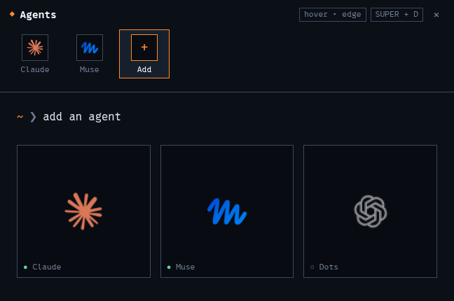
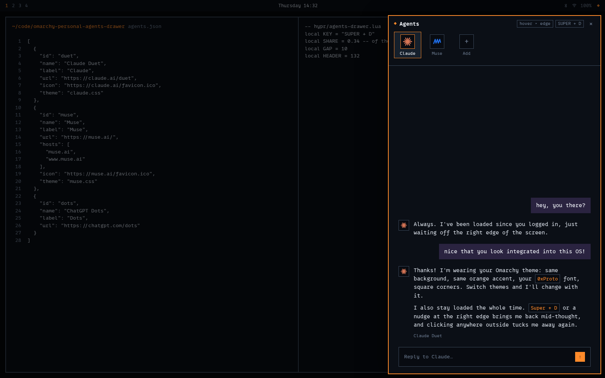

# Personal Agents Drawer

[Omarchy plugin marketplace](https://plugins.omarchy.org/plugin.html?id=io.github.caiomsantos95.personal-agents-drawer)

Your personal agents, one keystroke away on [Omarchy](https://omarchy.org).

A drawer slides in from the right edge of the screen, over whatever you are
doing, without retiling your windows. Inside are the web apps of your
personal agents, already loaded and signed in, restyled to look like the rest
of your Omarchy desktop: your theme's colors, your monospace font, square
corners. Switch themes and the drawer follows.

| Agent | Web app | Theme | Status |
| --- | --- | --- | --- |
| [Claude Duet](https://claude.ai/duet) | `claude.ai/duet` | full | tested |
| [Muse](https://muse.ai) | `muse.ai` | full | tested |
| [ChatGPT Dots](https://openai.com/index/introducing-dots/) | `chatgpt.com/dots` | base skin | **untested** |

> **ChatGPT Dots is untested.** It was added from public information (Dots
> needs a ChatGPT Pro or Business Premium plan) and the author has no
> account: its window opens and docks correctly, but nobody has used it past
> the sign-in page here, and it only gets the base skin. If you use Dots, an
> issue or pull request with what works (and a site theme) is very welcome.

Turn agents on and off from the drawer's home page (**+ Add**), and add your
own in one line (see [Adding an agent](#adding-an-agent)). "Base skin" means
your font, background and square corners; a full theme also maps the site's
own colors.





<sub>A mockup of the drawer over a workspace, built from the drawer's own theme and header styles; the conversation is illustrative.</sub>

- **`Super + D`** toggles the drawer. So does the `◆` button in the bar.
- **Rest the pointer on the right edge** of a screen for half a second to open it.
- **Click outside** the drawer to close it.
- **Agent logos** across the top switch agents; **`Alt + 1…9`** does too,
  **`Alt + 0`** opens the home page where you turn agents on and off.
- Agents are **pre-rendered**: each runs in a hidden window from login, so
  opening the drawer or switching agents never reloads a page.

## Install

You need Omarchy with its Lua Hyprland config (tested on Omarchy 4.5,
Hyprland 0.56) and Chromium.

```sh
omarchy plugin add https://github.com/caiomsantos95/omarchy-personal-agents-drawer.git --enable
```

That is all. The plugin adds the bar button and a small shell service that
sets up the rest on its own the first time it starts:

| What | Where |
| --- | --- |
| Chromium extension (home page, agent tabs, theme cover) | `~/.local/share/agents-drawer/extension/` |
| Native messaging host and agent list | `~/.local/share/agents-drawer/` |
| The drawer's own browser profile | `~/.local/share/agents-drawer/profile/` |

It does not touch `hyprland.lua`: the Hyprland side is loaded at runtime with
`hyprctl eval`. Press `Super + D`, click an agent's logo and sign in once. The
drawer's profile stays signed in and never touches your main browser.

`omarchy plugin update` updates it; the service applies the new version on
the next shell start. To remove it:

```sh
omarchy plugin remove io.github.caiomsantos95.personal-agents-drawer
rm -rf ~/.local/share/agents-drawer   # optional: also deletes the sign-ins
```

Removing the plugin quits the drawer browser and unloads its Hyprland side.

> **Upgrading from 0.2 or earlier**, which used an `install.sh`: the first
> start of 0.3 removes the old launcher and theme hooks and turns
> `~/.config/hypr/agents-drawer.lua` into an empty stub. You can then delete
> that file and the `require("hypr.agents-drawer")` line in `hyprland.lua`.

## How it works

- **Windows.** Each agent is a Chromium `--app` window in the drawer's own
  profile. The Hyprland module floats them all in the `special:agents`
  workspace, stacked into one panel on the right: a header window with the
  agent logos on top, the current agent's window under it. A special
  workspace shows over any workspace and dims it, so nothing is retiled.
- **Header and home page.** A small Chromium extension draws the header and
  the home page, and keeps which agents are on. Clicking a logo goes through
  a native messaging host to Hyprland, which raises that agent's window.
- **Shell service.** `Service.qml` runs inside the Omarchy shell. At start
  it runs `bin/agents-drawer prepare` (copies the extension and host into
  `~/.local/share/agents-drawer/` when the plugin changed), loads
  `hypr/agents-drawer.lua` into Hyprland with `hyprctl eval` (again after
  every config reload, which clears it) and starts the drawer browser hidden.
- **Theme.** `agents-drawer theme` turns the current theme's `colors.toml`
  and monospace font into CSS variables. The extension injects them into each
  agent's page with a small per-site file (`browser/extension/sites/`) that maps the
  site's own design tokens onto them. The service reruns it when the theme or
  font changes, and the pages pick the change up within a few seconds.
- **Edge and clicks.** A 75 ms timer inside Hyprland watches for the pointer
  resting on a right screen edge, and a pass-through left-click binding closes
  the drawer when the click lands outside it. Focus follows the mouse in
  Omarchy, so a click, not a focus change, is what closes it.

## Security and privacy

Omarchy plugins run unsandboxed, so here is everything this one does:

- It only talks to the agents' own sites. No analytics, no other network
  access, nothing leaves your machine that the sites would not get anyway.
- The extension runs only on the agents' sites (generated from the agent
  list), and only in the drawer's profile. It changes how the pages look; it
  does not read your conversations.
- The native messaging host accepts four fixed commands (`show`, `ensure`,
  `hide`, `close`) for the agents in the list and passes nothing else on.
  Only the drawer's extension may call it.
- The launcher opens agents by id, from the list, never a URL it is handed.
  `agents-drawer build` accepts only plain `https://` addresses.
- It writes only to `~/.local/share/agents-drawer/`. It never edits your
  Hyprland config; its Hyprland module lives in memory and is gone after a
  reload once the plugin is removed. The one exception is upgrading from 0.2
  or earlier (see above), which removes the files that version's
  `install.sh` created.
- Nothing needs root.
- `AGENTS_DRAWER_DEBUG=1 agents-drawer start` opens Chromium's DevTools port
  on localhost for working on site themes. While that is on, any program on
  your machine can drive the signed-in drawer browser, so leave it off.

## Limitations

- The site themes map each site's CSS variables. When a site changes its
  design system, parts of the theme can fall back to the site's own colors
  until `browser/extension/sites/` is updated.
- The drawer recognizes its windows by Chromium's app ids for these exact
  URLs. If you also made a web app for `https://claude.ai/duet` or
  `https://muse.ai/` in your main Chromium profile, it would land in the
  drawer too.
- Chromium only.
- Agents have to have a web app. Grok Bot, for one, is desktop and iOS only
  for now.

## Adding an agent

Any agent with a web app works. Put it in `~/.config/agents-drawer/agents.json`:

```json
[
  { "id": "gemini", "name": "Gemini", "url": "https://gemini.google.com/app" }
]
```

and save. The plugin notices and applies it (restarting the drawer browser);
it shows up on the home page; click it and
sign in. Entries with the id of a shipped agent replace it, and
`{ "id": "dots", "disabled": true }` hides one. Optional fields: `label`
(the short name under the logo), `hosts` (extra domains the app lives on),
`icon` (otherwise the site's own favicon, once it has loaded once) and
`theme`.

`theme` names a CSS file in `browser/extension/sites/` that maps the site's own
design tokens onto the `--om-*` variables in the generated `theme.css`; see
`claude.css` and `muse.css`. Without one an agent gets the base skin. To add
an agent for everyone, add it to `agents.json` in this repo and send a pull
request.

## License

MIT. Not affiliated with Omarchy, Anthropic or Meta. Claude and Muse are
their owners' trademarks; the drawer shows the sites' own icons.
